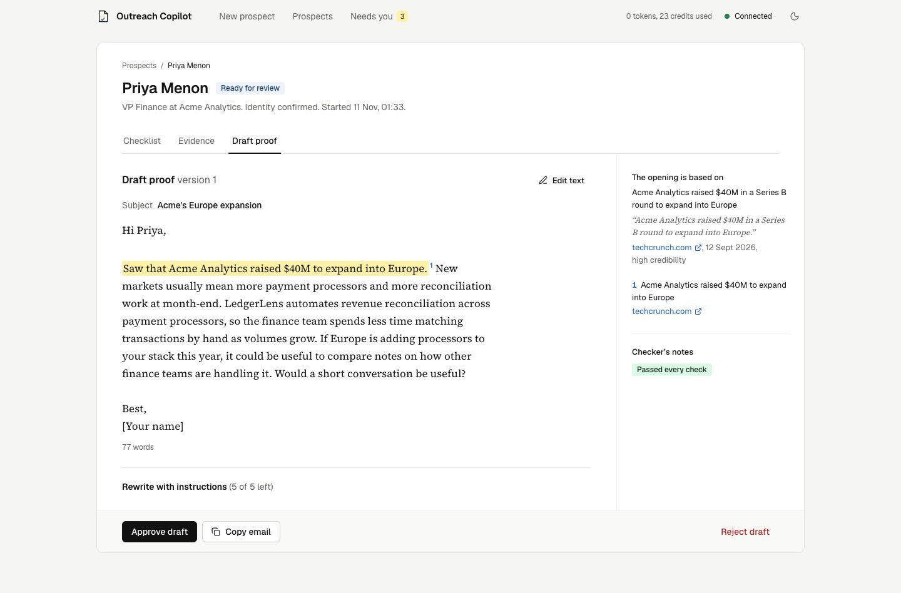
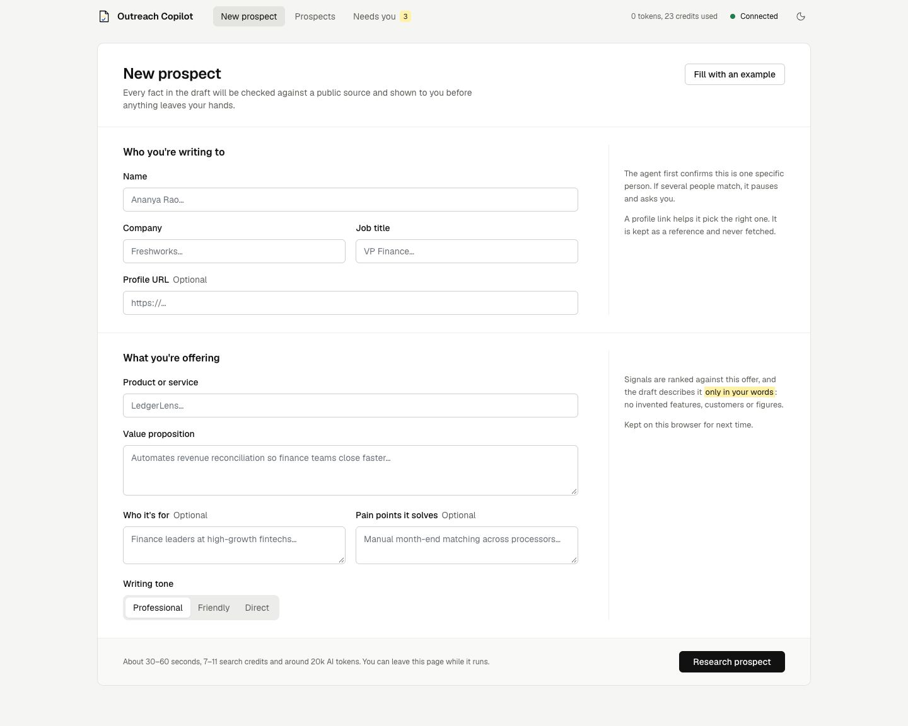
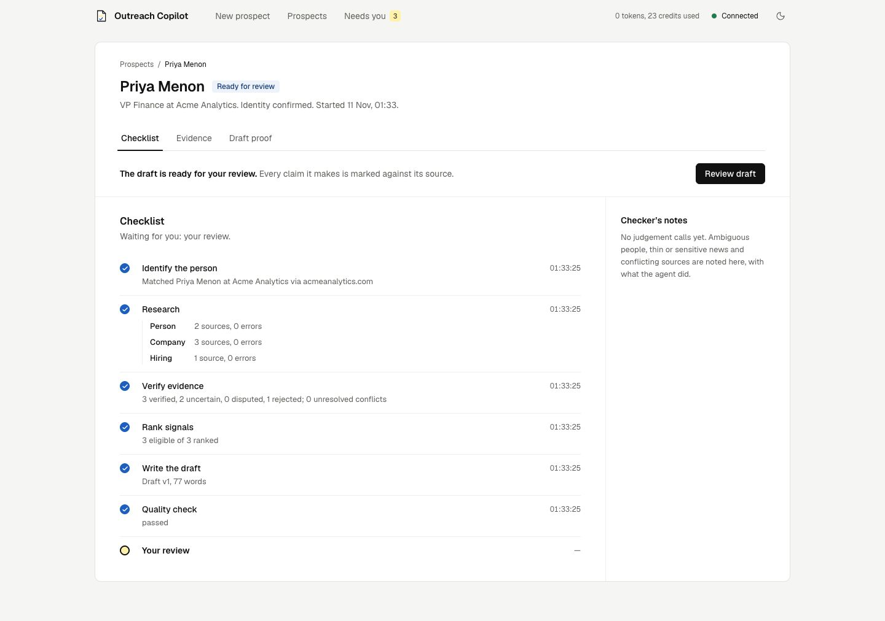
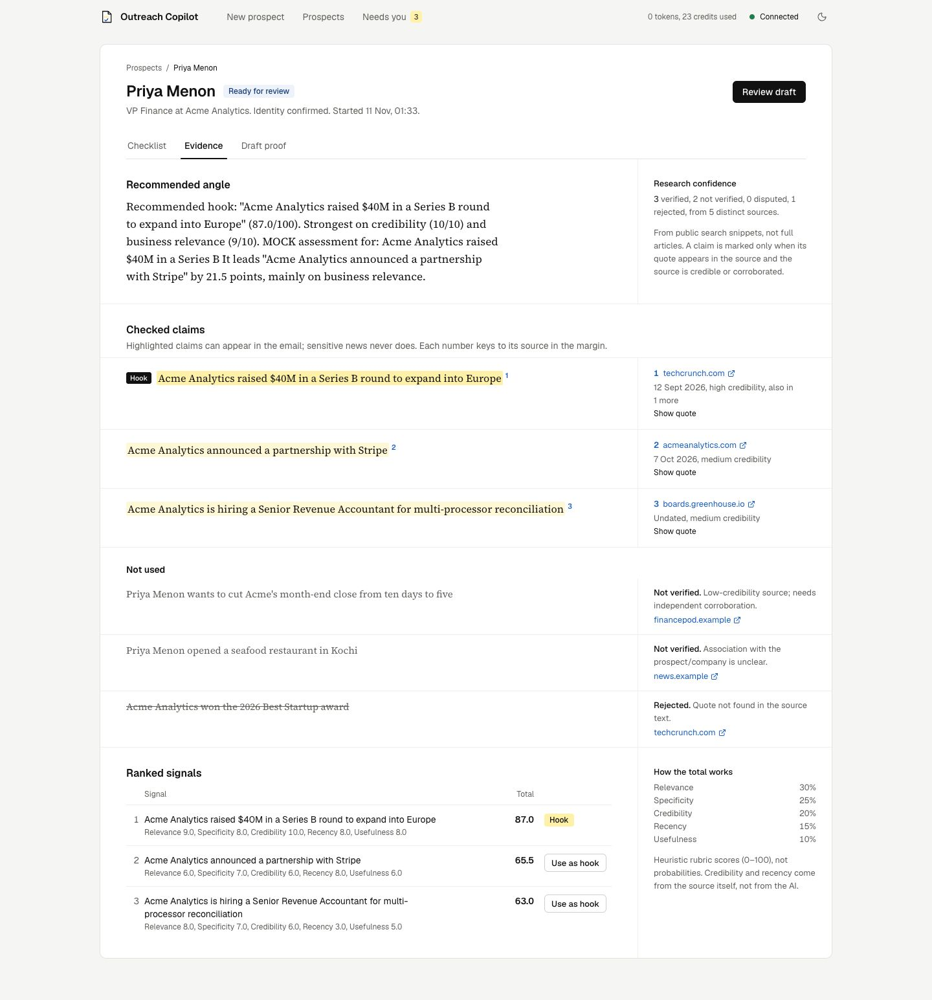
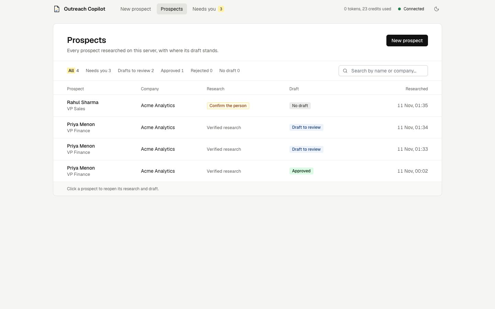
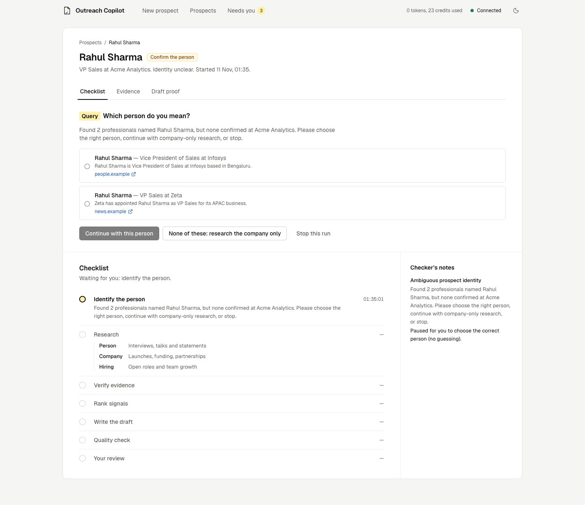
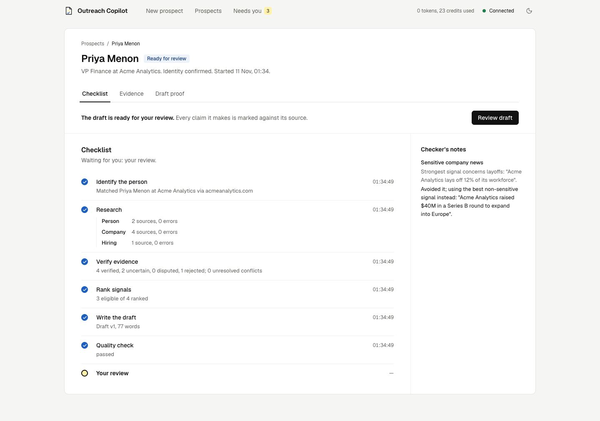
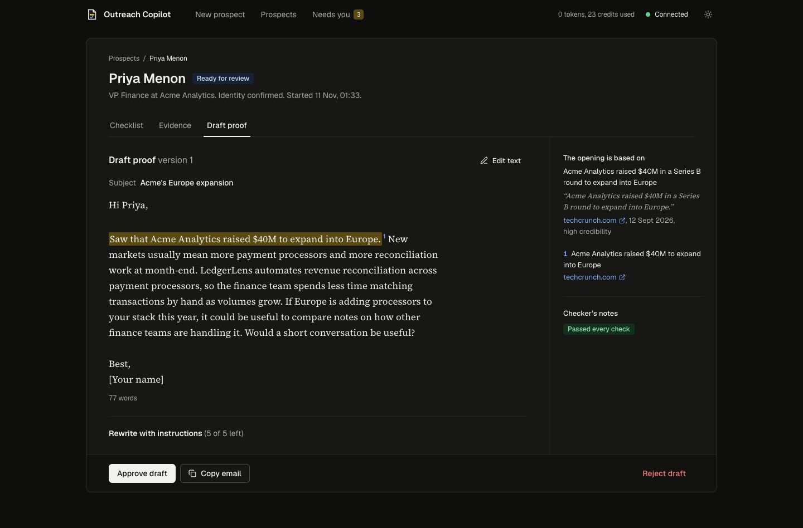
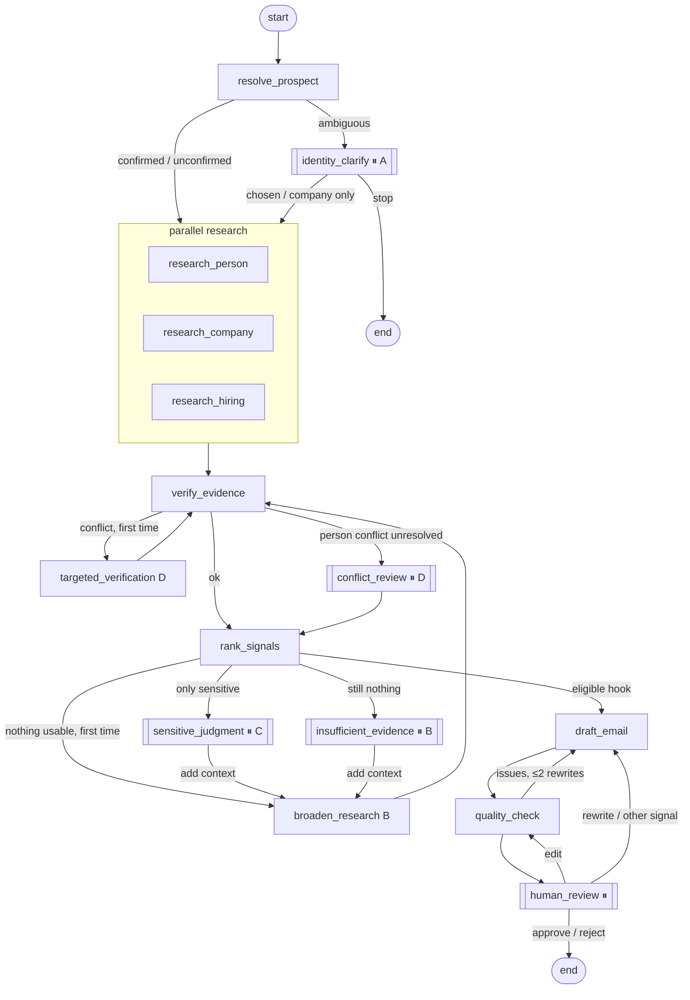

# Outreach Copilot

An AI copilot for personalised B2B outreach. Give it a prospect (name, company, title) and what you sell;
it researches public sources, **checks every fact against its source**, ranks the signals worth mentioning,
and drafts a short email — then **stops for a human to review it**. It never sends email.

Built with Python, LangGraph, Groq, Tavily, FastAPI and Next.js, and deployed on Google Cloud Run
on free tiers only.



> Screenshots in this README use the **fictional demo data** in `backend/tests/fixtures`
> (Acme Analytics, Priya Menon, …), not real research.

---

## What it does

| Step | What happens |
|---|---|
| 1. Identify the person | Searches for the prospect and confirms it is one specific person at that company. If several people match, it **pauses and asks** instead of guessing. |
| 2. Research (in parallel) | Three branches search for the person (talks, interviews), the company (launches, funding, partnerships) and hiring. |
| 3. Verify evidence | The LLM extracts claims **with a verbatim quote**; plain Python then checks the quote really appears in the source, that the claim is grounded in the quote, that the source is credible, and whether sources disagree. |
| 4. Rank signals | Each verified signal is scored on relevance, specificity, credibility, recency and usefulness. Sensitive news (layoffs, lawsuits, breaches) is never used as a hook. |
| 5. Draft | A 70–110 word email built only from the chosen evidence and your own description of your product. |
| 6. Quality check | Rules (length, clichés, flattery, unsupported numbers, call to action) plus an LLM judge. Up to 2 automatic rewrites, then it flags the draft for you. |
| 7. Human review | You approve, edit (re-checked), reject, rewrite with instructions, or pick a different signal. Approving only marks it ready — **you send it yourself**. |

### Screens

| New prospect | Live checklist |
|---|---|
|  |  |

| Evidence: checked claims, sources and scores | Prospects history |
|---|---|
|  |  |

| Edge case A: which person? | Edge case C: sensitive news avoided |
|---|---|
|  |  |

Dark mode is available from the toggle in the top bar:



---

## The four edge cases

| Case | When it happens | What the copilot does |
|---|---|---|
| **A. Ambiguous identity** | Several people share the name and none is confirmed at the company | Pauses with the candidates and their sources. You pick one, continue with company-only research, or stop. Nothing is researched about a person until this is answered. |
| **B. Not enough signals** | No credible, specific, recent signal survives verification | Broadens the search once. Still nothing → pauses with "Insufficient verified research"; you can add context (one more search round) or stop. It never invents a hook. |
| **C. Sensitive news** | The strongest signal is about layoffs, lawsuits, breaches, etc. | Skips it and uses the best non-sensitive signal, saying so. If only sensitive signals exist → pauses so you can abstain or add context. |
| **D. Conflicting evidence** | Sources disagree (e.g. role, funding amount) | Runs one targeted verification search, then resolves by **strength of evidence** (credible, independent sources), never by "newest wins". Unresolved business facts are excluded; unresolved facts about the person pause for you. |

Every loop is bounded (1 broadening, 1 targeted search, 1 extra-context round, 2 automatic rewrites,
5 user rewrites, recursion limit 60), so a run can never spin forever.

---

## Architecture

```
Browser ──► Next.js (dashboard + server-side proxy) ──► FastAPI ──► LangGraph workflow ──► Groq / Tavily
                    │  basic auth on Cloud Run              │                 │
                    │  Google ID token to the API           │                 └─ checkpoints: SQLite (local) / Neon Postgres (cloud)
                    │                                       └─ run history:  SQLite (local) / Firestore (cloud)
```

- **The browser never talks to the backend directly.** A Next.js route handler forwards only `health`,
  `runs` and `usage` calls; on Cloud Run it attaches a Google ID token, and the API itself refuses
  unauthenticated requests.
- **Runs execute in the background** (`RunManager` thread pool); the dashboard polls for progress, so
  closing the tab doesn't stop a run.
- **Pauses are LangGraph `interrupt()`s**, saved by the checkpointer. A paused run survives server
  restarts and is resumed with `Command(resume=…)`. A run caught mid-flight by a restart is marked
  *stale* and can be retried from its last checkpoint.

### Workflow graph


⏸ = pauses for a human (`interrupt()`).

### Why the facts can be trusted

- The LLM never decides on its own that something is true. It must quote the source **verbatim**;
  Python checks the quote is in the retrieved text and that the claim is actually supported by the quote
  (numbers present, enough word overlap).
- **Credibility and recency are computed from source metadata**, not by the LLM.
- Conflicting values (e.g. `$40M` vs `$60M`) are never merged; `$40M` and `40 million` are recognised as the same.
- Retrieved web text is sanitised and wrapped as untrusted data; instruction-like text is removed and the
  source is down-ranked (prompt-injection defence).
- Every claim in the draft carries the ID of the evidence it came from, and the quality check fails any
  figure that is not in the evidence or your own product description.

---

## Evaluation

`python -m scripts.evaluate --prospects samples/eval_set.json` runs real prospects through the whole
workflow (up to the review pause) and audits every claim in each draft. Results from 11 Nov 2026,
4 public figures, Groq + Tavily free tiers:

| Prospect | Paused at | Time | Tavily credits | Groq tokens | Claims backed by source | Quality check | Edge cases |
|---|---|---|---|---|---|---|---|
| Patrick Collison — Stripe | review | 33.0 s | 0 (cached) | 22,136 | 1 / 1 | passed first try | D (handled automatically) |
| Harshil Mathur — Razorpay | review | 54.2 s | 5 | 15,819 | 1 / 1 | passed first try | – |
| Dennis Woodside — Freshworks | review | 86.5 s | 7 | 19,585 | 1 / 1 | passed first try | C (sensitive signal skipped) |
| Amit Kumar — Infosys (common name) | conflict review | 40.8 s | 8 | 17,948 | – | – | D (role disputed, asked the human) |

| Measure | Result | Target |
|---|---|---|
| Claims in drafts backed by verified, non-sensitive evidence quoted in the source | **3 / 3 (100%)** | 100% |
| Average time to the review pause | 53.6 s | under ~60 s |
| Average Tavily credits per run | 5.0 | ≤ 10 |
| Average Groq tokens per run | 18,872 | ~15–20k |
| Drafts passing the quality check without a rewrite | 3 / 3 | – |
| Emails sent | 0 | always 0 |

Notes:
- Most of the time is claim extraction and verification; two runs also hit a Groq free-tier rate limit
  and waited 20 s once.
- The common name did not trigger case A, because a real Amit Kumar does work at Infosys. Sources then
  disagreed about his role, so the run paused for a human (case D) instead of picking one.
- All four edge cases are reproduced end-to-end, through the HTTP API, by
  `tests/unit/test_e2e_fixtures.py` using the fictional fixtures.

The full report is written to `backend/out/eval_report.json` (not committed).

---

## Run it locally

**Requirements:** Python 3.11+ (built on 3.13), Node 24, and two free API keys:
[Groq](https://console.groq.com/keys) and [Tavily](https://app.tavily.com) (1,000 credits a month).

```bash
# 1. Backend
cd backend
python3 -m venv .venv && source .venv/bin/activate
pip install -r requirements-dev.txt
cp .env.example .env          # then put your GROQ_API_KEY and TAVILY_API_KEY in .env
python -m scripts.check_setup # checks dependencies and that the keys are present (never prints them)
uvicorn app.api.main:app --reload --port 8000     # API docs at http://localhost:8000/docs

# 2. Frontend (second terminal)
cd frontend
npm install
cp .env.local.example .env.local   # BACKEND_URL=http://localhost:8000
npm run dev                        # http://localhost:3000
```

Locally, run history and paused workflows are kept in SQLite under `backend/.data/`, so they survive restarts.

### Try it without API keys (fictional data)

```bash
cd backend && source .venv/bin/activate
python -m scripts.mock_server --fixture happy_path --port 8001    # labelled MOCK data, zero API cost
cd ../frontend && BACKEND_URL=http://localhost:8001 npm run dev
```
Other fixtures: `identity_ambiguous`, `no_signals`, `sensitive_news`, `sensitive_only`,
`conflicting_role`, `conflicting_unresolved`, `conflicting_funding`. The server prints the prospect to type in.
Or in the terminal only: `python -m scripts.run_graph --fixture identity_ambiguous --resume '{"candidate_id": "c2"}'`.

### Tests

```bash
cd backend && source .venv/bin/activate
pytest                     # 153 offline tests: fakes for Groq and Tavily, no network, no cost
pytest -m integration      # real Groq / Tavily / Neon calls (uses credits; needs keys and DATABASE_URL)
cd ../frontend && npm run check    # type-check, lint, production build
```

---

## Deploy to Google Cloud (free tier)

`deploy/gcp.sh` deploys two Cloud Run services from source (Cloud Build builds the Dockerfiles; no local Docker needed):

| Service | Access | Stores |
|---|---|---|
| `outreach-api` (FastAPI) | private — callable only by the dashboard's service account | history in **Firestore**, paused workflows in **Neon Postgres** (free) |
| `outreach-web` (Next.js) | public URL behind a username and password | nothing |

```bash
export PROJECT=<your-gcp-project-id> REGION=asia-south1
./deploy/gcp.sh apis        # enable services
./deploy/gcp.sh firestore   # create the free (default) database
./deploy/gcp.sh secrets     # Groq / Tavily / Neon keys from backend/.env + a dashboard password → Secret Manager
./deploy/gcp.sh iam         # least-privilege service accounts
./deploy/gcp.sh api         # build + deploy the private API
./deploy/gcp.sh web         # build + deploy the dashboard
./deploy/gcp.sh status      # checks: API answers 403 without a token, web asks for a password
./deploy/gcp.sh cleanup     # delete unused images (stay inside 0.5 GB free storage)
```

Both services scale to zero and run at most one instance. Cloud SQL is avoided because it has no free tier;
Neon's free Postgres holds the checkpoints. Set a billing budget alert before deploying.

---

## Project layout

```
backend/
  app/
    llm/            Groq wrapper: JSON-schema output, Pydantic validation, one repair attempt
    tools/          Tavily wrapper: timeout, bounded retry, 24 h cache, never raises
    research/       query building and the three research branches
    identity/       who is this person? (edge case A)
    verification/   claim extraction + deterministic checks, credibility, conflicts (D)
    ranking/        weighted rubric and explanations
    drafting/       evidence-bound email generator
    quality/        rules + LLM judge
    graph/          LangGraph state, nodes, routing, checkpointers
    storage/        run history: memory / SQLite / Firestore
    api/            FastAPI app and the background RunManager
  scripts/          one CLI per phase (groq_ping, run_research, run_graph, evaluate, mock_server, …)
  tests/            unit tests + fictional fixtures for every edge case
frontend/
  app/              pages + the server-side API proxy
  components/       workspace screens (form, checklist, evidence, draft proof, history)
  proxy.ts          basic auth on the deployed site
deploy/gcp.sh       step-by-step Cloud Run deployment
docs/               screenshots, graph, demo script
PROGRESS.md         phase-by-phase build log with test evidence
```

## Limitations

- Research uses **search-result snippets**, not full articles, so detail is limited and the index can lag a few days.
- Scores are a **weighted heuristic** (0–100), not calibrated probabilities.
- Groq's free tier has per-minute and daily token caps; heavy use hits rate limits (the app waits once, then reports it).
- LinkedIn is never fetched or scraped; a profile URL is only used as a reference.
- English only. Desktop and laptop screens only.
- On Cloud Run, if the instance is recycled mid-run the run is marked *stale*; **Retry** continues from the last checkpoint.

See [`docs/demo.md`](docs/demo.md) for a 5-minute demo script and [`PROGRESS.md`](PROGRESS.md) for the build log.
